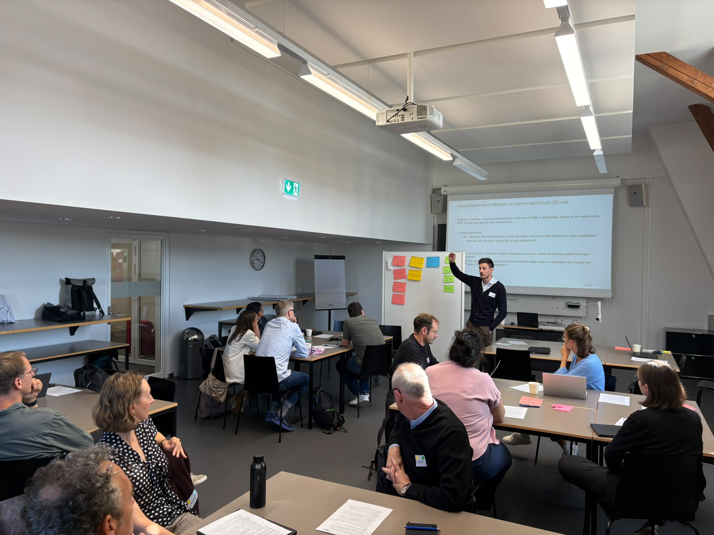

::: {.callout-note title="Source"}
Repost with permission. The [original article](https://yearofscientometrics.ethz.ch/open-and-responsible-scientometric-evidence-insights-from-the-7th-syos-workshop/) was published by the Swiss Year of Scientometrics (SYoS) on 3 November 2026.
:::

**How can Swiss higher education institutions work together to strengthen scientometric evidence? The 7th Swiss Year of Scientometrics (SYoS) workshop brought together participants to discuss responsible indicator use, the opportunities offered by open research information and possibilities for closer collaboration.**

Held at the University of Bern on 17 September 2026, the workshop contributed to [NAIF Track 1](https://eth-library.github.io/naif/about.html#track-1-responsible-use-of-quantitative-indicators) on the responsible use of quantitative scientometric indicators (QSI). Dr William Aeberhard (ETH Zurich) and Dr Alexander Ehlert (ETH Zurich) moderated the event.

## Setting the scene: Current practices and open research information

Moritz Twente (University of Basel) presented findings from the NAIF survey on responsible QSI use at Swiss institutions. Dr Christophe Schneble (University of Bern) complemented this overview with an in-depth look of research assessment and QSI use at the University of Bern.

A further input by Alexander Ehlert (ETH Zurich) introduced the Open Bibliometric Study of the ETH Domain, developed jointly by ETH Zurich and EPFL using OpenAlex. The project illustrated the potential of open data and reproducible methods for cross-institutional collaborations, while also highlighting some of its challenges with affiliation information and disciplinary classifications.

## Exploring needs and opportunities in small groups

{fig-alt="A presenter stands beside a projected slide and points at it, while seated participants listen at tables in a workshop room."}

Participants discussed three topics in small groups before sharing their findings in plenary:

1. Current and future uses of scientometric evidence.
2. Opportunities and challenges of open research information.
3. Ways to jointly advance responsible and open scientometric evidence in Switzerland.

The discussions highlighted several priorities:

- **Matching indicators to their purpose** – Scientometric evidence serves different needs, including institutional reporting, strategic planning, research assessment, rankings and identifying emerging topics. Participants stressed the importance of context and disciplinary differences and questioned how well existing indicators capture contributions such as research data, outreach and societal impact.
- **Making open data useful** – Open research information offers opportunities for greater transparency, accessibility and broader coverage. Using it effectively requires investment in data quality, technical infrastructure and expertise. Participants identified author and affiliation disambiguation and disciplinary coverage as challenges but also as opportunities for improvement over existing services and highlighted the need for joint work.
- **Improving data at the source** – Correcting information in shared sources such as OpenAlex would allow institutions to build on one another's contributions. Coordinated curation could reduce duplicated effort, enhance comparability and improve the evidence available to all users.
- **Pooling expertise and infrastructure** – The discussions highlighted strong interest in pooling expertise, data curation and technical resources to develop shared scientometric services for Switzerland. Institutions with established expertise and infrastructure could provide a foundation for this effort, opening their tools and workflows to wider participation. A common platform would allow institutions to contribute according to their strengths, benefit from collective improvements and develop services around shared needs.

## Moving forward

There was broad support for exploring closer collaboration, while its precise scope and organisational form remained open. Suggestions for follow-up included establishing a shared discussion space and preparing a concrete proposal for joint organisation and its funding.

As NAIF approaches its conclusion, the workshop provided a basis for continuing this conversation within the SYoS community and beyond. Pooling expertise and resources could help make reliable, contextualised scientometric evidence more accessible across Swiss institutions.

::: {.callout-note title="Author"}
Dr Alexander Ehlert is a data scientist in the Research Analytics Service at ETH Library.
:::
